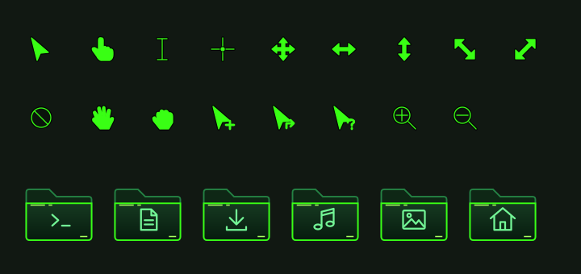

# Noctalia + Niri — Hacker Neon

Backup restaurável do desktop de Ueverton Passos, capturado em **14/10/2026**, com atalhos e energia atualizados em **19/10/2026**: preto, verde neon `#39ff14`, wallpaper tech, terminal inspirado no Kali e tela de bloqueio Matrix.

Este repositório inclui o **Noctalia personalizado completo**, porque copiar somente `settings.json` não recupera as mudanças feitas no launcher, nas notificações, no menu de sessão e na tela de bloqueio.

## Restaurar após reinstalar o sistema

No **CachyOS**, entre no usuário que usará o desktop e execute:

```bash
git clone git@github.com:uevertonpassos/noctalia-and-niri-config.git
cd noctalia-and-niri-config
./install-deps.sh
./install.sh
```

Se ainda não configurou sua chave SSH no sistema novo, clone por HTTPS:

```bash
git clone https://github.com/uevertonpassos/noctalia-and-niri-config.git
```

Depois, encerre a sessão e escolha **Niri** na tela de login. Execute os scripts **como seu usuário normal**. `install-deps.sh` usa sudo para instalar pacotes, adicionar seu usuário ao grupo `input` e configurar o módulo `uinput`. `install.sh` restaura os arquivos da home sem sudo. O shell de login não é alterado: o Alacritty já abre o Zsh com Oh My Zsh.

O novo login também ativa as permissões de entrada e os atalhos do Nautilus. O serviço `mx-master-window-scroll.service` já fica habilitado para iniciar com a sessão gráfica; ele aguarda o mouse quando estiver desconectado e volta a conectá-lo automaticamente.

O instalador adapta os caminhos para a sua home, copia as fontes e o wallpaper, valida a configuração com o Niri instalado e salva os arquivos anteriores em:

```text
~/.local/state/hacker-neon/backups/<data-hora>/
```

Para conferir antes de instalar:

```bash
./install.sh --dry-run
```

Para gerar as configurações em outra pasta sem alterar sua sessão:

```bash
./install.sh --target /tmp/minha-config-restaurada --no-session
```

Os arquivos de `home/` são modelos com o marcador `@HOME@`. Use o instalador para convertê-los em caminhos válidos; não copie os modelos diretamente sobre a home.

## O que está incluído

| Parte | Configuração |
| --- | --- |
| Noctalia | Barra superior verde, relógio monoespaçado, CPU/RAM/rede, dock desativado, menus e notificações |
| Niri | Bordas verdes, espaçamento, transparência/blur, workspaces TERM/WEB/CODE e atalhos |
| Tela de bloqueio | Chuva Matrix, cores e componentes personalizados; autenticação original preservada |
| Terminal | Alacritty, Zsh, cópia do Oh My Zsh, prompt Kali Neon e plugins de sugestões/histórico/sintaxe |
| Monitor | btop com o tema Hacker Neon |
| Ícones e cursor | Pastas verdes e cursores neon com quatro tamanhos e animação de espera |
| Fontes | MesloLGS Nerd Font e Adwaita, com suas licenças |
| Wallpaper | O mesmo PNG usado no desktop original, sem edição |
| Aplicativos | Estilos GTK/Qt e scripts para reaplicar o tema nos navegadores |
| MX Master 3S | Roda lateral para janelas, botões laterais para desktops e botão do polegar para Codex |
| Pastas | Super + T contextual e scripts do Nautilus para terminal/Codex |
| Energia | Tela apaga em 10 minutos, bloqueia em 11 e suspensão automática por inatividade desativada |



## Atalhos principais

`Super` é a tecla Windows.

| Atalho | Ação |
| --- | --- |
| Super + T | Terminal na pasta selecionada, sob o ponteiro ou atual do Nautilus |
| Super + W | Launcher do Noctalia |
| Super + B | Firefox, como na configuração original |
| Super + E | Arquivos / Nautilus |
| Super + M | Monitor btop |
| Super + F1 | Painel completo de atalhos |
| Super + L | Bloquear a tela |
| Super + Shift + Q | Menu de sessão |
| Super + 1 / 2 / 3 | TERM / WEB / CODE |
| Super + Ctrl + 1 / 2 / 3 | Mover a coluna para outra área |
| Super + O | Visão geral |
| Roda lateral do MX Master 3S | Janela à esquerda / direita |
| Botão lateral traseiro / dianteiro | Desktop anterior / próximo |
| Botão na base do polegar | Codex na pasta selecionada ou atual do Nautilus |

### Terminal e Codex nas pastas

No Nautilus, **Super + T** dá prioridade à pasta selecionada. Sem seleção, abre e fecha o menu de contexto para selecionar o item sob o ponteiro; sobre uma pasta, abre o terminal nela. Em uma área vazia, usa a pasta atual. A identificação da seleção usa a acessibilidade do GTK; se essa consulta não estiver disponível, usa a seleção/pasta atual fornecida pelo Nautilus. Fora do gerenciador, abre na pasta pessoal. Selecionar mais de uma pasta pede que você escolha uma.

O botão na base do polegar abre **Codex** na pasta selecionada; sem seleção, usa a pasta atual do Nautilus. Fora dele, usa a pasta pessoal. Os dois scripts também aparecem no menu **Scripts** do Nautilus. `F19` e `Shift + F19` são usados internamente para acionar esses scripts; mantenha essas combinações livres.

Instale o [Codex CLI](https://developers.openai.com/codex/cli/) separadamente e execute `codex login`. O lançador procura `~/.local/bin/codex` e depois o comando `codex` no PATH. O repositório não inclui o binário, as credenciais nem as conversas do Codex. O terminal comum funciona sem ele.

O remapeamento foi configurado com o **MX Master 3S via Bluetooth**, cujo botão da base emite `BTN_FORWARD` (277). A roda vira F23/F24, e o botão da base vira F18, interpretado como `XF86Launch9` pelo mapa de teclado incluído. Se outro modelo/conexão emitir códigos diferentes, ajuste o script do mouse. Os atalhos nativos MouseBack/MouseForward também se aplicam a outros mouses e substituem voltar/avançar no navegador.

O grupo `input` permite ler os eventos usados pelo remapeador e verificar se as teclas modificadoras foram soltas. A regra `system/70-hacker-neon-uinput.rules` permite ao mesmo grupo criar os dispositivos virtuais; `system/hacker-neon-uinput.conf` carrega o módulo no boot. Para reaplicar somente essas permissões após instalar os pacotes:

```bash
bash scripts/setup-input.sh
```

Depois, entre novamente na sessão. Para verificar o serviço ou desativar o remapeamento:

```bash
systemctl --user status mx-master-window-scroll.service
systemctl --user disable --now mx-master-window-scroll.service
```

### Tela apagada e chamadas

A configuração mantém os aplicativos ativos quando a tela apaga ou bloqueia. **Super + Shift + P** apaga apenas os monitores. Suspender/hibernar manualmente ou fechar a tampa ainda pode interromper chamadas; o ajuste desativa somente a suspensão automática por inatividade do Noctalia.

## Brave, Chromium e Firefox

Após reinstalar cada navegador, abra-o uma vez para criar o perfil e feche todas as suas janelas. Depois execute:

```bash
python3 scripts/browser-theme.py
```

O script aplica as cores escuras/verdes aos perfis locais existentes, incluindo o modo mais escuro do Brave e o CSS do Firefox. Preserva as demais preferências e cria backups em `~/.local/state/hacker-neon/browser-backups/`. Perfis com um arquivo de bloqueio são recusados; feche o navegador e tente novamente.

O repositório contém somente a aparência dos navegadores. Contas, favoritos, histórico, cookies, senhas e extensões instaladas não são exportados. Para esses dados, use a sincronização ou um backup próprio do navegador.

## Compatibilidade e fidelidade

A referência é **CachyOS com Niri 26.04 e noctalia-qs 0.0.12**, usando teclado brasileiro ABNT2. A cópia local do Noctalia identifica-se como **4.7.7**, mesmo que o pacote do sistema tenha outra versão. Essa cópia é instalada em `~/.config/quickshell/noctalia-shell` e tem prioridade sobre o Noctalia do sistema.

As versões detectadas estão em [versions.json](versions.json). O instalador de dependências usa os pacotes disponíveis nos repositórios do CachyOS; ele não congela nem rebaixa o sistema. O runtime, drivers, escala e resolução podem mudar a aparência. Para obter a maior fidelidade, use as versões de referência e a mesma escala. O instalador recusa configurações que o Niri instalado não consiga analisar.

O wallpaper tem um padrão global, então também aparece se o monitor tiver um nome diferente de `eDP-1`. A resolução não é fixada; ajuste `~/.config/niri/cfg/display.kdl` quando necessário. Em outra distribuição, o logotipo da barra acompanha a distribuição.

As fontes, o código personalizado e os assets ficam no repositório, sem depender de downloads futuros desses temas. O plugin Polkit do Noctalia é o único agente iniciado pelo pacote restaurado; o autostart redundante do agente GNOME foi retirado para evitar conflito.

Atualizar manualmente a cópia local do Noctalia pode substituir as personalizações. Mantenha este repositório como referência antes de atualizar.

## Onde editar

| Arquivos | Finalidade |
| --- | --- |
| `home/.config/noctalia/settings.json` | Barra, menus e comportamento |
| `home/.config/noctalia/colors.json` | Paleta ativa |
| `home/.config/noctalia/colorschemes/Noite Serena/` | Paleta persistente |
| `home/.config/quickshell/noctalia-shell/` | Código completo do Noctalia personalizado |
| `home/.config/niri/` | Compositor, atalhos e workspaces |
| `home/.local/bin/mx-master-window-scroll.py` | Remapeamento do MX Master 3S |
| `home/.config/systemd/user/` | Serviço do mouse e habilitação na sessão gráfica |
| `home/.local/bin/*-launcher.py` | Abertura contextual do terminal e Codex |
| `home/.local/share/nautilus/scripts/` e `home/.config/nautilus/scripts-accels` | Integração com a seleção do gerenciador |
| `system/` e `scripts/setup-input.sh` | Permissões persistentes de entrada e módulo uinput |
| `home/.config/alacritty/` e `home/.zshrc` | Terminal e shell |
| `home/.config/oh-my-zsh/custom/themes/` | Prompt Kali Neon |
| `home/.local/share/icons/` | Ícones e cursores |
| `extras/` | Preferências de aparência dos navegadores |

O manifesto SHA-256 detecta arquivos ausentes ou modificados. Depois de editar intencionalmente o conteúdo de `home/`, atualize-o e teste:

```bash
python3 scripts/update-manifest.py
python3 -m unittest discover -s tests -v
./install.sh --dry-run
```

Para recuperar um arquivo anterior, copie-o de `backups/<data-hora>/files/` para o mesmo caminho relativo na sua home. `restore-record.json` informa quais arquivos existiam antes da restauração.

## Créditos

Consulte [THIRD_PARTY.md](THIRD_PARTY.md). As licenças dos componentes redistribuídos acompanham suas cópias. O wallpaper foi preservado do arquivo local escolhido pelo usuário; este repositório não declara autoria sobre ele.
